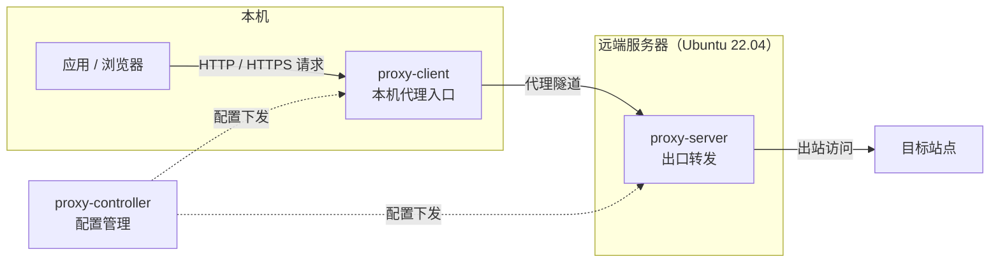
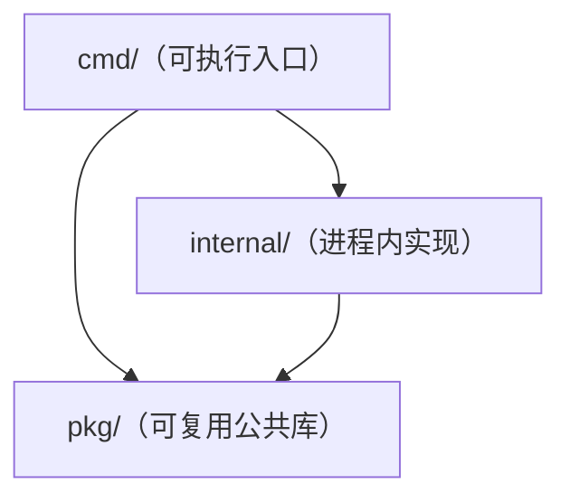

# Proxy

[](https://github.com/OopsOo0ps/proxy/actions/workflows/ci.yml)
[](go.mod)
[](LICENSE)

Proxy 是一个从零构建、面向 Ubuntu 22.04 的生产级正向代理工具：**客户端 / 服务端分离部署，控制端集中管理配置**，追求轻量、干净、长期可演进。

> 当前处于脚手架阶段（v0.x）：标准工程布局与 CI 已就绪，代理核心功能将按路线图逐步交付，详见「限制说明」。

## 架构



- 实线：数据流方向（请求逐级转发，响应沿原路返回）。
- 虚线：控制流方向（控制端向客户端 / 服务端下发配置）。
- 代码依赖方向：`cmd/` → `internal/` → `pkg/`（详见「项目结构」）。

## 特性

当前状态：脚手架已就绪，代理能力按路线图逐步合入。

已就绪：

- 标准 Go 工程布局：`cmd/` / `internal/` / `pkg/` 分层，依赖方向清晰
- 统一开发入口：`make build` / `test` / `lint` / `run`
- CI 自动化：GitHub Actions 在 ubuntu-22.04 上执行构建、测试与 golangci-lint

规划中：

- HTTP / HTTPS 正向代理核心
- 客户端 ↔ 服务端代理隧道（传输与加密）
- 控制端动态配置
- 智能分流：内网直连、外网走隧道
- 低内存、低 CPU 占用，适合长期驻留
- 面向 Ubuntu 22.04 的部署与运维支持（systemd 等）

## 快速开始

环境要求：Go 1.25+（仅构建需要）；生产运行目标为 Ubuntu 22.04。

```sh
git clone https://github.com/OopsOo0ps/proxy.git
cd proxy
make build
./bin/proxy-server -version
```

开发期可直接前台运行：

```sh
make run        # 构建并启动 proxy-server（骨架阶段：启动后等待退出信号）
make test       # 运行单元测试
make lint       # 运行 golangci-lint（首次自动下载到 .bin/）
```

三个二进制各自的角色：

| 二进制 | 角色 | 当前状态 |
| --- | --- | --- |
| `proxy-server` | 远端出口，转发代理流量 | 骨架 |
| `proxy-client` | 本机代理入口 | 骨架 |
| `proxy-controller` | 配置管理 CLI | 骨架 |

## 项目结构

```text
├── cmd/                  # 可执行入口（三个独立二进制）
│   ├── server/           #   proxy-server
│   ├── client/           #   proxy-client
│   └── controller/       #   proxy-controller
├── internal/             # 仅本仓库使用的进程内实现
│   └── logging/          #   日志初始化
├── pkg/                  # 可被外部复用的公共库
│   └── version/          #   版本信息（构建期注入）
├── Makefile              # 开发入口（build / test / lint / run ...）
└── .github/workflows/    # CI（构建 + 测试 + golangci-lint）
```

代码依赖方向（上层可依赖下层，禁止反向依赖）：



## 开发

- `make build`：构建三个二进制到 `bin/`（自动注入版本信息）
- `make test`：运行全部单元测试
- `make lint`：静态检查（golangci-lint v2，首次自动下载）
- `make fmt` / `make vet`：格式化与基础检查
- CI 与本地使用同一套 Makefile 目标，行为一致

## 限制说明

- 当前为脚手架阶段，尚未实现代理转发能力，不可用于生产环境。
- 生产运行目标平台为 Ubuntu 22.04；其他平台尚未验证。
- 二进制参数、包结构与对外接口处于早期阶段，可能随迭代调整。
- 尚未发布正式版本与发行包，请通过源码构建使用。

## 路线图

- [x] 仓库基础：布局 / Makefile / CI / 文档
- [ ] HTTP / HTTPS 正向代理核心
- [ ] 客户端 ↔ 服务端隧道（传输与加密）
- [ ] 控制端动态配置
- [ ] 智能分流与内网直连
- [ ] 部署与运维（systemd / 发行包）

## 参与贡献

见 [CONTRIBUTING.md](CONTRIBUTING.md)。

## 许可证

[MIT](LICENSE)
