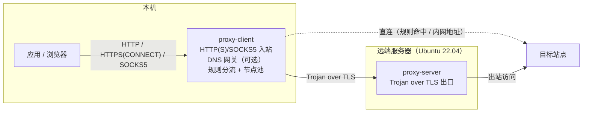

# Proxy

[](https://github.com/OopsOo0ps/proxy/actions/workflows/ci.yml)
[](go.mod)
[](LICENSE)
[](https://www.bestpractices.dev/projects/15378)

Proxy 是一个从零构建、面向 Ubuntu 22.04 的生产级正向代理工具：**客户端 / 服务端分离部署，控制端集中管理配置**，追求轻量、干净、长期可演进。

当前版本已具备可用的代理核心：本机 HTTP/HTTPS 与 SOCKS5 入站、基于 Trojan（over TLS）的隧道出站（多节点轮询 + 主动健康检查摘除 / 自动加回 + 失败冷却转移）、域名分流（本地规则文件 / 远程 URL 动态加载）、可选 DNS 网关（remote DNS）、认证、结构化日志、Prometheus 指标与健康/状态端点。

深入内容（配置字段、运维语义、验证记录与边界说明）在 [Wiki](https://github.com/OopsOo0ps/proxy/wiki)，索引见文末「文档」。

## 架构



- 实线：数据流方向（请求逐级转发，响应沿原路返回）。
- 虚线：直连路径（规则命中或内网地址时不经出口节点）。
- 代码依赖方向：`cmd/` → `internal/`（分层约束由 `internal/arch` 守护测试强制）。

## 特性

已交付的代理核心：

| 能力 | 说明 |
| --- | --- |
| HTTP/HTTPS 入站 | 支持 `CONNECT` 隧道与绝对地址形式的 HTTP 请求转发 |
| SOCKS5 入站 | TCP `CONNECT`；用户名/密码认证可选（RFC 1928 / RFC 1929） |
| 隧道出站 | Trojan over TLS；出口节点轮询、主动健康检查（连续失败摘除 / 连续成功加回）、失败冷却切换 |
| 连接池 | 上游隧道预热池：启动预热、请求领取，省去一次完整握手；空闲数与 TTL 可配，失效自动回退新建 |
| 优雅关闭 | SIGTERM/SIGINT 后停止接受新连接，存量请求排空后退出；超时强制断开剩余连接 |
| 背压（过载保护） | 进程级并发连接上限（默认 1024，0 = 不限制）；超限返回明确错误并计入 `connections_rejected_total` |
| 分流 | 规则文件驱动 direct / proxy；环回与私网地址默认直连 |
| 规则集动态加载 | 本地 `rules_file` 或远程 `rules_url` 二选一；周期刷新、失败保持现有规则、SIGHUP 立即重拉 |
| DNS 处理 | **remote DNS（默认）**：域名随隧道到出口解析；**可选 DNS 网关**：本机环回监听，按同一分流规则转发查询 |
| 认证 | 入站用户名密码 + 隧道口令；失败响应不泄露任何内部信息 |
| 日志 | `log/slog` 结构化 JSON，含 `request_id`、`client_ip`、`upstream`、`duration`；级别可运行时切换 |
| 配置热加载 | `SIGHUP` 先校验、后原子切换；失败保持旧配置继续服务 |
| 指标与端点 | `/metrics`（Prometheus）、`/health`（存活与依赖）、`/stats`（运行时快照） |

规划中：控制端动态配置、发行包（deb / apt）、UDP 与 TUN 支持（见「限制与边界」与「路线图」）。各能力的完整语义与边界见 [Wiki](https://github.com/OopsOo0ps/proxy/wiki)。

## 快速开始

环境要求：Go 1.25+ 与 make（构建用；Ubuntu 可 `apt install build-essential`）；演示需要 curl，DNS 验证需要 dig（缺失时自动跳过）。生产运行目标为 Ubuntu 22.04。

```sh
git clone https://github.com/OopsOo0ps/proxy.git
cd proxy
make demo   # 一条命令跑通：构建 → 启动本机三节点演示 → 四项验证
```

输出形如（数值随网络环境变化）：

```text
  server-1 已启动（pid 10823）
  ...（server-2 / server-3 / client 同理）
  HTTP 入站 http://127.0.0.1:18080 ｜ SOCKS5 127.0.0.1:11080 ｜ DNS 网关 127.0.0.1:1053 ｜ 指标 http://127.0.0.1:19100/metrics
演示已就绪：make demo-check 验证 / make demo-down 停止。
HTTP/HTTPS 入站（CONNECT 隧道）：HTTP 200，耗时 0.7s
SOCKS5 入站：HTTP 200，耗时 0.7s
DNS 网关（经出口节点远程解析 example.com）：172.66.147.243 104.20.23.154
Prometheus 指标（客户端，非零项节选）：
  active_connections{proto="socks5"} 1
  requests_total{proto="http",result="ok",route="proxy"} 1
  requests_total{proto="socks5",result="ok",route="proxy"} 1
  ...
演示完成：make demo-down 停止演示进程。
```

### 本地三节点演示（分步）

演示来自仓库自带的 `configs/local/`（3 个出口节点 + 1 个客户端）；`make demo` 结束后进程保持运行便于继续观察，也可以分步使用：

```sh
make demo-up     # 只启动：生成自签证书并后台运行（日志与 PID 在 var/demo/）
make demo-check  # 只验证：HTTP 入站 / SOCKS5 入站 / DNS 网关 / Prometheus 指标
make demo-down   # 只停止：SIGTERM 优雅关停
```

值得注意：

- 入站认证失败会收到标准 `407`（固定文案，不泄露任何内部信息）；直接访问任一节点端口（如 `https://127.0.0.1:18443`）只会看到一张中性伪装网页。
- 客户端日志（`configs/local/client.yaml` 中 `format: json`）包含逐请求的 `request_id`、`client_ip`、`upstream`、`duration` 字段；每个节点默认预热 2 条空闲隧道，可在指标 `upstream_pool_*` 观察。
- 停掉任一节点进程（PID 在 `var/demo/*.pid`）可观察故障自愈：连续探测失败后该节点被摘除（`/stats` 中 `removed: true`），重启并连续探测成功后自动加回。

演示端口与凭据集中在 `configs/local/`；Makefile 的 `DEMO_*` 变量与之对应、可覆盖。更多观察点与指标含义见 [Wiki：可观测性](https://github.com/OopsOo0ps/proxy/wiki/可观测性)。

### 生产部署

生产模板在 `configs/example-*.yaml`（客户端默认 8080 / 1080 / 9100，服务端默认 8443 / 9200），本地试验可直接前台运行（`Ctrl-C` 优雅关停）：

```sh
make run-server SERVER_CONFIG=configs/example-server.yaml   # 远端出口
make run-client CLIENT_CONFIG=configs/example-client.yaml   # 本机入口
```

正式部署使用 Docker 镜像（distroless 最小版 <30MB + 排错版）或 systemd 单元（Ubuntu 22.04，含沙箱加固），完整步骤见 [Wiki：部署指南](https://github.com/OopsOo0ps/proxy/wiki/部署指南)。

## 配置

配置为 YAML 且严格解析：**未知字段会直接导致启动失败**，避免拼写错误被静默忽略。核心字段（完整字段与语义见 [Wiki：配置参考](https://github.com/OopsOo0ps/proxy/wiki/配置参考)）：

```yaml
# proxy-client（本机入口）；完整注释版见 configs/example-client.yaml。
inbound:
  http: "127.0.0.1:8080"     # HTTP/HTTPS 入站（CONNECT + 绝对地址请求）
  socks5: "127.0.0.1:1080"   # SOCKS5 入站（TCP CONNECT）
  auth:                      # 入站认证；监听非环回地址时必填
    - username: alice
      password: change-me

nodes:                       # 出口节点（Trojan over TLS），建议 ≥3
  - addr: "node1.example.com:443"
    password: node1-token
    sni: www.example.com     # 可选：TLS SNI / 证书校验名

routing:
  default: proxy             # direct | proxy
  rules_file: ""             # 规则源二选一：本地 rules_file 或远程 rules_url
  private_direct: true       # 环回 / 私网 / 链路本地目标一律直连

pool:                        # 上游空闲隧道连接池（预热复用；0 = 关闭）
  max_idle: 2
  idle_ttl: 5s               # 应明显小于服务端 timeouts.handshake

health_check:                # 出口节点主动健康检查（故障自愈）
  interval: 10s              # 0 = 关闭
  failures: 3                # 连续失败 N 次摘除
  successes: 2               # 摘除后连续成功 M 次自动加回

timeouts:                    # 纯数字按秒解释
  dial: 10s                  # 建立目标 / 节点连接
  handshake: 10s             # 隧道握手（TLS + Trojan）
  failover: 30s              # 出口节点故障转移总预算（全部候选节点合计）
  shutdown: 15s              # 优雅关停排空期限

limits:
  max_connections: 1024      # 进程级并发上限（HTTP + SOCKS5 合计）；0 = 不限制

metrics:
  listen: "127.0.0.1:9100"   # /metrics、/health、/stats；默认仅允许环回，非环回需 allow_remote: true
log:
  level: info                # debug | info | warn | error
  format: json               # json | text
```

```yaml
# proxy-server（远端出口）；完整注释版见 configs/example-server.yaml。
listen: "0.0.0.0:8443"       # Trojan over TLS 隧道
tls:
  cert_file: server.crt
  key_file: server.key
users:                       # 每个客户端分配独立凭据
  - username: alice
    password: change-me-alice
limits:
  max_connections: 1024      # 进程级并发隧道上限
metrics:
  listen: "127.0.0.1:9200"
```

入口校验：监听非环回地址时必须配置 `inbound.auth`，否则启动直接报错。

进一步的主题：

- [Wiki：分流与规则](https://github.com/OopsOo0ps/proxy/wiki/分流与规则) — `rules_file` 语法、内网直连、远程规则定时刷新。
- [Wiki：DNS-策略](https://github.com/OopsOo0ps/proxy/wiki/DNS-策略) — remote DNS 默认行为与可选 DNS 网关。
- [Wiki：运行时语义](https://github.com/OopsOo0ps/proxy/wiki/运行时语义) — 配置热加载（SIGHUP）、优雅关闭、过载保护。

## 可观测性

配置 `metrics.listen` 后，同一端口暴露四个端点：

| 端点 | 用途 |
| --- | --- |
| `GET /metrics` | Prometheus 指标（请求、连接、连接池、健康探测、规则源、DNS） |
| `GET /health` | 存活与依赖检查；依赖不可用时返回 503 |
| `GET /stats` | 运行时快照：连接数、出口节点状态、规则源状态、内存 |
| `GET` / `PUT /log/level` | 查询 / 运行时切换日志级别（无需重启） |

以下端口来自生产示例配置（本机演示对应 19100）：

```sh
curl -s http://127.0.0.1:9100/health
curl -s http://127.0.0.1:9100/stats | python3 -m json.tool
curl -s -X PUT "http://127.0.0.1:9100/log/level?level=debug"
```

指标全表、日志字段、出口节点健康检查（主动探测 + 被动冷却）与 `/stats` 完整字段见 [Wiki：可观测性](https://github.com/OopsOo0ps/proxy/wiki/可观测性)。运维端点默认仅允许绑定环回地址；确需远程只读访问时可显式设置 `metrics.allow_remote: true`（仍不做鉴权，请配合防火墙）。`PUT /log/level` 是状态变更，永远只接受环回来源，不受该开关影响。

## 安全

- 入站代理支持用户名/密码认证（HTTP `Proxy-Authorization` / SOCKS5 RFC 1929）；监听非环回地址时**强制**要求认证。
- 隧道凭据以 SHA-224 摘要形式在 TLS 内传输；服务端凭据存储只保留摘要，比较全部使用常量时间实现，避免时序侧信道。
- 失败响应不泄露信息：入站统一回标准 407 / SOCKS5 通用失败码（固定文案）；隧道层对认证失败与非协议流量返回中性伪装网页（可用 `decoy_file` 自定义），与普通 Web 服务无法区分。
- 出口节点证书校验默认开启；`insecure_skip_verify` 仅供自签调试，请勿在生产使用。
- 漏洞报告流程见 [SECURITY.md](SECURITY.md)：GitHub 私密漏洞报告已启用，承诺 14 天内首次响应。

## 限制与边界

- **仅有显式代理的 TCP**：暂不支持 UDP（SOCKS5 `UDP ASSOCIATE` 与 Trojan UDP 转发），也没有 TUN / 透明代理模式；未配置代理的程序不会被接管。
- **remote DNS 的前提**：应用需把域名交给代理（CONNECT / `socks5h`）或经 DNS 网关解析；应用自行解析后连 IP 时，域名分流与防污染均不适用。
- **健康检查不校验隧道口令**：口令错误等隧道层问题由真实流量的被动冷却兜底；摘除判定按探测周期累计（默认最坏约 30s，期间少量请求可能失败）。
- **连接池存在回收窗口**：空闲连接可能被服务端按握手超时回收；请保持 `pool.idle_ttl` 明显小于服务端 `timeouts.handshake`。
- **热加载不覆盖监听地址**：`inbound.*` / `listen` 等变更会被明确拒绝并提示重启。
- 生产目标平台为 Ubuntu 22.04，尚未提供发行包（deb / apt 源）与集中配置下发。

完整清单（连接上限语义、远程规则边界、收尾中止不可区分等）见 [Wiki：限制与边界](https://github.com/OopsOo0ps/proxy/wiki/限制与边界)。

## 性能与容量

性能数字均有实测依据（热路径基准 + 真机压测，完整条件与表格见 [Wiki：性能与容量](https://github.com/OopsOo0ps/proxy/wiki/性能与容量)）：

- **基准**（`go test -bench`，本机 M4 / Ubuntu 22.04 VPS 中位数）：CONNECT 入站握手 ≈72.5µs / ≈226µs；转发循环搬运 1MiB ≈14.7GB/s / ≈4.05GB/s（均 0 allocs）。
- **单机压力**（2 vCPU / 3.6GB，每请求新建隧道）：三档并发下吞吐恒定 ≈670 RPS、**全程 0 失败**——过载以排队（延迟）吸收而非丢请求；该实例冷路径容量 ≈700 RPS。
- **隧道长连接**：1k / 5k / 10k 条持久隧道 100% 建立、0 失败；规划经验值约 **200KB / 条隧道（双进程合计）**。

基准只在本机回环运行，用于追踪热路径回归，不代表公网吞吐。

## 项目结构

```text
├── cmd/                  # 可执行入口（两个独立二进制）
│   ├── server/           #   proxy-server（远端出口）
│   └── client/           #   proxy-client（本机入口）
├── configs/              # 示例配置（生产模板 + 本地三节点演示）
├── internal/
│   ├── arch/             #   依赖方向守护测试（go list -deps 矩阵，make test 拦截）
│   ├── auth/             #   凭据存储与常量时间校验
│   ├── clientapp/        #   proxy-client 组装与端到端测试
│   ├── config/           #   配置解析、默认值与校验
│   ├── connlimit/        #   进程级并发连接上限（背压）
│   ├── connpool/         #   上游隧道预热池（connect-then-bind 契约）
│   ├── core/             #   核心契约（Target / Route / 拨号·认证·遥测接口）
│   ├── dialer/           #   路由感知的出站拨号（实现 core.TargetDialer）
│   ├── dnsgw/            #   可选 DNS 网关（分流感知的 DNS 转发）
│   ├── httpproxy/        #   HTTP/HTTPS 入站（CONNECT + 转发）
│   ├── logging/          #   slog 初始化、request_id 与运行期级别/格式切换
│   ├── metrics/          #   Prometheus 指标（L4 适配层，实现各组件 Observer）
│   ├── netutil/          #   网络小工具
│   ├── nodes/            #   出口节点池（轮询/冷却/切换；节点携带传输实现）
│   ├── outbound/         #   出口传输契约（Transport/Prewarmer/Prober）与一致性验收
│   ├── relay/            #   双向转发（半关闭/空闲超时）
│   ├── routing/          #   分流规则引擎
│   ├── ruleset/          #   规则源（本地文件 / 远程 URL）与定时刷新
│   ├── serverapp/        #   proxy-server 组装
│   ├── session/          #   入站 accept/drain 生命周期（socks5/trojan 共用）
│   ├── shutdown/         #   优雅关停排空原语
│   ├── socks5/           #   SOCKS5 入站与地址编码
│   ├── sockswire/        #   SOCKS5 线格式编解码
│   ├── status/           #   运行时状态快照（/stats）
│   ├── testutil/         #   测试辅助（自签证书）
│   ├── trojan/           #   Trojan 协议（客户端传输实现 / 服务端）
│   └── version/          #   版本信息（构建期 ldflags 注入）
├── test/integration/     #   黑盒集成测试（真实二进制端到端）
├── Dockerfile            # 容器镜像（多阶段：最小版 / 排错版，linux/amd64）
├── deploy/systemd/       # systemd 单元（Ubuntu 22.04，含沙箱配置）
├── Makefile              # 开发入口（build / test / cover / lint ...）
└── .github/workflows/    # CI（构建 + 测试 + golangci-lint + Docker 镜像）
```

## 开发

- `make build`：构建三个二进制到 `bin/`（自动注入版本信息）
- `make version`：打印两个二进制的版本信息
- `make test`：运行全部单元测试（含端到端、黑盒集成与混沌用例，不依赖外部网络）
- `make cover`：运行测试并打印总覆盖率
- `make lint`：静态检查（golangci-lint v2，首次自动下载）
- `make demo`：一条命令跑通本地三节点演示；分步使用 `make demo-up` / `make demo-check` / `make demo-down`
- `make run-server` / `make run-client`：前台运行（`SERVER_CONFIG` / `CLIENT_CONFIG` 指定配置）
- `make dev-cert`：生成本地演示用自签证书
- `make docker-build` / `make docker-build-debug`：构建容器镜像
- `make help`：查看全部目标

测试覆盖清单（端到端断言、集成与混沌场景）与真机验证记录见 [Wiki：测试与验收](https://github.com/OopsOo0ps/proxy/wiki/测试与验收)。

## 路线图

- [x] 仓库基础：布局 / Makefile / CI / 文档
- [x] HTTP / HTTPS 正向代理核心（CONNECT + 绝对地址转发）
- [x] SOCKS5 入站（TCP CONNECT + 可选认证）
- [x] 客户端 ↔ 服务端隧道（Trojan over TLS，多节点）
- [x] 基础域名分流与内网直连
- [x] 认证、结构化日志、Prometheus 指标
- [x] 连接池（上游隧道预热复用）与转发缓冲复用（`sync.Pool`）
- [x] 优雅关闭（drain）与背压（连接上限 + 明确错误）
- [x] 热路径基准测试（本机 + Ubuntu 22.04 对照）
- [x] 动态日志级别（`/log/level` 运行时切换）
- [x] DNS 处理策略（remote DNS 默认 + 可选 DNS 网关；fake-IP 权衡与下一步条件记录）
- [x] 配置热加载（SIGHUP：校验失败保持旧配置，成功原子生效）
- [x] 上游故障自愈（主动健康检查：连续失败摘除、连续成功自动加回；被动冷却转移）
- [x] 规则集动态加载（远程 URL 拉取 + 定时刷新；失败保持现有规则，SIGHUP 立即重拉）
- [x] 集成测试（黑盒：构建并启动真实二进制，验证分流、指标与半关闭传播）
- [x] 混沌测试（最小版：SIGKILL 上游 → 自动摘除 / 流量转移 / 自动加回；含真机演练）
- [x] Docker 镜像（多阶段构建；最小版 <30MB + 排错版，linux/amd64）
- [x] systemd unit 文件（Ubuntu 22.04 原生部署，含沙箱；真机验证）
- [x] 压力测试报告（1k/5k/10k 并发曲线；单机回环真机实测，0 失败）
- [ ] 控制端动态配置
- [ ] 发行包（deb / apt 源）
- [ ] UDP（SOCKS5 UDP ASSOCIATE）与 TUN 模式

## 文档

| 文档 | 内容 |
| --- | --- |
| [Wiki：配置参考](https://github.com/OopsOo0ps/proxy/wiki/配置参考) | 客户端 / 服务端全部字段、默认值与语义 |
| [Wiki：分流与规则](https://github.com/OopsOo0ps/proxy/wiki/分流与规则) | 规则语法、内网直连、远程规则动态加载 |
| [Wiki：DNS-策略](https://github.com/OopsOo0ps/proxy/wiki/DNS-策略) | remote DNS、DNS 网关、与 fake-IP 的取舍 |
| [Wiki：运行时语义](https://github.com/OopsOo0ps/proxy/wiki/运行时语义) | 配置热加载、优雅关闭、过载保护 |
| [Wiki：可观测性](https://github.com/OopsOo0ps/proxy/wiki/可观测性) | 指标全表、运维端点、日志与健康检查机制 |
| [Wiki：部署指南](https://github.com/OopsOo0ps/proxy/wiki/部署指南) | Docker 镜像与 systemd 单元（Ubuntu 22.04） |
| [Wiki：性能与容量](https://github.com/OopsOo0ps/proxy/wiki/性能与容量) | 基准测试、压力测试与容量规划 |
| [Wiki：测试与验收](https://github.com/OopsOo0ps/proxy/wiki/测试与验收) | 测试覆盖与真机验证记录 |
| [Wiki：限制与边界](https://github.com/OopsOo0ps/proxy/wiki/限制与边界) | 完整限制清单 |
| [Wiki：FAQ](https://github.com/OopsOo0ps/proxy/wiki/FAQ) | 常见问题速查 |
| [CONTRIBUTING.md](CONTRIBUTING.md) | 开发环境、提交规范与测试要求 |
| [SECURITY.md](SECURITY.md) | 漏洞报告流程 |
| [CHANGELOG.md](CHANGELOG.md) | 变更记录 |

## 参与贡献

见 [CONTRIBUTING.md](CONTRIBUTING.md)。问题与功能建议请提交至
[GitHub Issues](https://github.com/OopsOo0ps/proxy/issues)。

## 发行版本

- 变更记录：[CHANGELOG.md](CHANGELOG.md)
- 发行说明与下载：[GitHub Releases](https://github.com/OopsOo0ps/proxy/releases)

## 许可证

[MIT](LICENSE)
