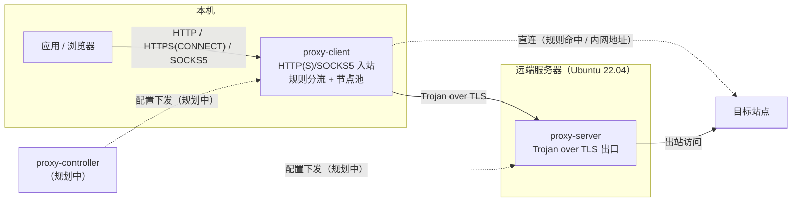

# Proxy

[](https://github.com/OopsOo0ps/proxy/actions/workflows/ci.yml)
[](go.mod)
[](LICENSE)

Proxy 是一个从零构建、面向 Ubuntu 22.04 的生产级正向代理工具：**客户端 / 服务端分离部署，控制端集中管理配置**，追求轻量、干净、长期可演进。

当前版本已具备可用的代理核心：本机 HTTP/HTTPS 与 SOCKS5 入站、基于 Trojan（over TLS）的隧道出站（多节点自动切换）、域名分流、认证、结构化日志、Prometheus 指标与健康/状态端点。

## 架构



- 实线：数据流方向（请求逐级转发，响应沿原路返回）。
- 虚线：控制流方向；`proxy-controller` 仍为骨架，配置下发尚未实现。
- 代码依赖方向：`cmd/` → `internal/` → `pkg/`。

## 特性

已交付的代理核心：

| 能力 | 说明 |
| --- | --- |
| HTTP/HTTPS 入站 | 支持 `CONNECT` 隧道与绝对地址形式的 HTTP 请求转发 |
| SOCKS5 入站 | TCP `CONNECT`；用户名/密码认证可选（RFC 1928 / RFC 1929） |
| 隧道出站 | Trojan over TLS；出口节点轮询、失败自动切换与冷却退避 |
| 连接池 | 上游隧道预热池：启动预热、请求领取，省去一次完整握手；空闲数与 TTL 可配，失效自动回退新建 |
| 优雅关闭 | SIGTERM/SIGINT 后停止接受新连接，存量请求排空后退出；超过 `timeouts.shutdown`（默认 15s）强制断开剩余连接 |
| 分流 | 规则文件驱动 direct / proxy；环回与私网地址默认直连 |
| 认证 | 入站用户名密码 + 隧道口令；失败响应不泄露任何内部信息 |
| 日志 | `log/slog` 结构化 JSON，含 `request_id`、`client_ip`、`upstream`、`duration` |
| 指标 | `/metrics` 暴露 `requests_total`、`request_duration_seconds`、`active_connections` |
| 健康检查 | `/health` 存活与依赖检查；依赖不可用时返回 503（`proxy-client` 检查出口节点池，`proxy-server` 检查 TLS 证书有效期） |
| 运行时状态 | `/stats` 运行时快照：活跃连接数、出口节点状态（健康 / 连续失败 / 冷却剩余）、内存占用 |

规划中：控制端动态配置、systemd / 发行包、UDP 与 TUN 支持（见「限制说明」与「路线图」）。

## 快速开始

环境要求：Go 1.25+（仅构建需要）；生产运行目标为 Ubuntu 22.04。

```sh
git clone https://github.com/OopsOo0ps/proxy.git
cd proxy
make build
./bin/proxy-server -version
```

### 本地三节点演示

仓库自带一套本机演示配置（3 个出口节点 + 1 个客户端），可直接验证完整链路：

```sh
make dev-cert    # 生成本地自签证书到 var/

./bin/proxy-server -config configs/local/server-1.yaml &
./bin/proxy-server -config configs/local/server-2.yaml &
./bin/proxy-server -config configs/local/server-3.yaml &
./bin/proxy-client -config configs/local/client.yaml &

# HTTP/HTTPS 入站（浏览器同款 CONNECT 隧道）
curl -x http://127.0.0.1:18080 -U alice:change-me https://example.com

# SOCKS5 入站
curl --socks5-hostname 127.0.0.1:11080 -U alice:change-me https://example.com

# Prometheus 指标
curl -s http://127.0.0.1:19100/metrics | grep -E 'requests_total|request_duration_seconds|active_connections'
```

补充观察点：

- 不带 `-U` 访问会收到 `407 Proxy Authentication Required`（认证失败不带任何内部信息）。
- 直接访问节点 `https://127.0.0.1:18443` 会看到一张中性的伪装网页（不暴露代理存在）。
- 客户端日志（`configs/local/client.yaml` 中 `format: json`）包含逐请求的
  `request_id`、`client_ip`、`upstream`、`duration` 字段。
- 客户端默认会为每个节点预热空闲隧道（每节点 2 条），可在 `/metrics` 中通过
  `upstream_pool_*` 指标观察预热与领取情况。

### 生产部署（示意）

```sh
# 服务端（远端出口）
./bin/proxy-server -config configs/example-server.yaml

# 客户端（本机入口）
./bin/proxy-client -config configs/example-client.yaml
```

## 配置

配置为 YAML 且严格解析：**未知字段会直接导致启动失败**，避免拼写错误被静默忽略。
完整字段见 `configs/` 目录中的示例，以下为核心字段总览。

### 客户端 `proxy-client`

```yaml
inbound:
  http: "127.0.0.1:8080"    # HTTP/HTTPS 入站（CONNECT + 绝对地址请求）
  socks5: "127.0.0.1:1080"  # SOCKS5 入站（TCP CONNECT）
  auth:                     # 入站认证；监听非环回地址时必填
    - username: alice
      password: change-me

nodes:                      # 出口节点（Trojan over TLS），建议 ≥3
  - addr: "node1.example.com:443"
    password: node1-token
    sni: www.example.com    # 可选：TLS SNI / 证书校验名
  - addr: "node2.example.com:443"
    password: node2-token
  - addr: "node3.example.com:443"
    password: node3-token

pool:                       # 上游空闲隧道连接池（预热复用）
  max_idle: 2               # 每节点最大空闲连接数；0 = 关闭
  idle_ttl: 5s              # 空闲连接最长保留时间；应小于服务端 handshake 超时

tls:
  ca_file: ""                 # 自签证书时填写 CA 路径
  insecure_skip_verify: false # 仅调试：跳过证书校验

routing:
  default: proxy        # direct | proxy
  rules_file: ""        # 例如 configs/example-rules.yaml
  private_direct: true  # 环回 / 私网 / 链路本地目标一律直连

timeouts: { dial: 10s, handshake: 10s, idle: 90s, shutdown: 15s }
metrics:  { listen: "127.0.0.1:9100" } # 指标与运维端点（/metrics、/health、/stats）
log:      { level: info, format: json }   # json | text
```

入口校验：监听非环回地址时必须配置 `inbound.auth`，否则启动直接报错。

#### 上游连接池（预热复用）

`proxy-client` 会为每个出口节点预热 `pool.max_idle` 条“已完成 TLS 握手、尚未发送请求”
的空闲隧道连接；请求到来时直接领取并补发 Trojan 请求，省去一次到节点的完整握手往返。

- 领取时做存活探测：服务端已关闭、或已按握手超时回收的连接会被丢弃并回退新建，
  失效领取不计入节点失败，不影响既有的冷却与故障切换；
- 空闲超过 `pool.idle_ttl` 的连接会被回收；请保持该值小于服务端
  `timeouts.handshake`（默认 10s），否则连接可能在池中已被服务端回收；
- 预热采用“启动预热 + 领取后按需补齐”，空闲期不产生周期性握手流量；
- 预热拨号失败只计数与记录 debug 日志，节点健康仍由真实请求的被动拨号更新。

### 优雅关闭（graceful shutdown）

`proxy-client` 与 `proxy-server` 收到 `SIGTERM` / `SIGINT` 后按两阶段退出：

1. **停止接受**：立即关闭入站监听，新连接被拒绝（不再有新请求进入）；
2. **排空存量**：已在途的请求 / 隧道继续完成，不受关停影响，最长等待
   `timeouts.shutdown`（默认 15s）；
3. **超时退出**：期限用尽后强制断开仍未结束的连接，记录 warn 日志后退出（退出码 0）。

两类“没有在途数据”的连接会在关停一开始就被立即关闭，避免拖满关停期限：

- 客户端：上游连接池中的空闲（已握手、未发送请求）隧道；
- 服务端：握手期、尚未读到完整请求的连接（主要是客户端连接池的预热连接）。

排空完成后日志出现 `shutdown: all in-flight connections drained`；超时强制断开时
出现 `shutdown: timeout exceeded, remaining connections closed`。

### 服务端 `proxy-server`

```yaml
listen: "0.0.0.0:8443"       # Trojan over TLS 隧道
tls: { cert_file: server.crt, key_file: server.key }
users:                       # 每个客户端分配独立凭据
  - { username: alice, password: change-me-alice }
decoy_file: ""               # 可选：认证失败时的伪装页面
timeouts: { dial: 10s, handshake: 10s, idle: 90s, shutdown: 15s }
metrics:  { listen: "127.0.0.1:9200" } # 指标与运维端点（/metrics、/health、/stats）
log:      { level: info, format: json }
```

### 分流规则 `rules_file`

```yaml
default: proxy   # 未命中任何规则时：direct | proxy
rules:
  - action: direct
    match:
      - "localhost"        # 精确域名
      - "*.example.com"    # 通配子域名（不匹配裸域）
      - "1.2.3.4"          # 精确 IP
      - "192.168.0.0/16"   # CIDR 网段（IPv6 同样支持）
  - action: proxy
    match: ["*.google.com"]
```

- 规则自上而下匹配，**先命中者生效**；规则文件的 `default` 优先于客户端配置。
- 内置安全行为：环回、私网（RFC 1918 / ULA）、链路本地、组播地址与 `localhost`
  在 `private_direct: true`（默认）时一律直连，避免把内网流量误发到远端。

## 观测

### 指标（Prometheus）

任一进程配置 `metrics.listen` 后即可访问 `GET /metrics`：

| 指标 | 类型 | 标签 | 含义 |
| --- | --- | --- | --- |
| `requests_total` | counter | `proto`、`route`、`result` | 代理请求总数（含失败分类） |
| `request_duration_seconds` | histogram | `proto`、`route` | 请求耗时（秒） |
| `active_connections` | gauge | `proto` | 当前活跃连接数 |
| `upstream_pool_claims_total` | counter | `node`、`result` | 空闲连接领取结果（`hit` / `miss` / `stale`） |
| `upstream_pool_idle_connections` | gauge | `node` | 各节点当前空闲（已握手待用）连接数 |
| `upstream_pool_warm_failures_total` | counter | `node` | 后台预热拨号失败次数 |

`proto` 取值 `http` / `socks5` / `tunnel`；`route` 取值 `direct` / `proxy`；
`result` 取值 `ok` / `auth_fail` / `dial_fail` / `error`。
`upstream_pool_*` 系列仅 `proxy-client` 输出：连接池默认开启（`pool.max_idle: 2`），
关闭后不产生这些序列。

```sh
curl -s http://127.0.0.1:19100/metrics | grep requests_total
```

生产环境请将 `metrics.listen` 绑定到环回地址或置于防火墙之后（`/health`、`/stats` 与 `/metrics` 同址暴露）。

### 健康检查与运行时状态

`/health`、`/stats` 与 `/metrics` 共用 `metrics.listen` 监听（未配置则同样不启用）：

```sh
curl -s http://127.0.0.1:9100/health
# {"status":"ok","uptime":12.34}

curl -s http://127.0.0.1:9100/stats
# {"version":"...","uptime":12.34,"connections":{"http":1,"total":1},
#  "upstreams":[{"addr":"node1:443","healthy":true,"fails":0,"cooldown_remaining":0,"idle":2}],
#  "memory":{"alloc_bytes":...,"sys_bytes":...,"num_gc":...,"goroutines":...}}
```

- `GET /health`：进程存活时返回 `{"status":"ok","uptime":<秒>}`；依赖不可用时返回
  `503` 与 `{"status":"unavailable","reason":"..."}`。依赖定义：
  - `proxy-client`：配置了出口节点且没有任何健康节点（全部处于冷却）时不可用；
  - `proxy-server`：TLS 证书在运行中过期时不可用。
- `GET /stats`：运行时快照，字段见上例。`upstreams` 仅 `proxy-client` 输出；
  `proxy-server` 的 `connections` 只统计隧道连接。`upstreams[].idle` 是当前空闲
  预热连接数（未启用连接池时为 0）。
- 两个端点均只接受 `GET`（其它方法返回 405），与 `/metrics` 一样不做鉴权，
  请仅在环回地址或防火墙之后暴露。
- 节点健康状态来源于真实拨号的被动更新（失败后进入冷却），不发送主动探测；
  主动健康检查见路线图「基础故障转移」。

### 日志

基于标准库 `log/slog`，默认结构化 JSON（`format: text` 可切换为文本）。每条请求完成日志包含：

| 字段 | 说明 |
| --- | --- |
| `request_id` | 16 位十六进制随机关联 ID（crypto/rand） |
| `client_ip` | 来源地址 |
| `upstream` | 命中的出口节点地址；直连为 `direct`，连接池复用为 `pool` |
| `duration` / `duration_ms` | 可读耗时与毫秒数 |
| 其他 | `proto`、`target`、`route`、`result`、`bytes_up`、`bytes_down`、`user`（服务端）等 |

示例（客户端）：

```json
{"time":"...","level":"INFO","msg":"request completed","request_id":"8ea7571e7f8ede6b","proto":"http","client_ip":"127.0.0.1","method":"CONNECT","target":"example.com:443","route":"proxy","upstream":"127.0.0.1:18443","duration":"1.438054s","duration_ms":1438,"bytes_up":585,"bytes_down":4876,"result":"ok"}
```

## 安全

- 入站代理支持用户名/密码认证（HTTP `Proxy-Authorization` / SOCKS5 RFC 1929）；
  监听非环回地址时**强制**要求认证。
- 隧道凭据以 SHA-224 摘要形式在 TLS 内传输；服务端凭据存储只保留摘要，
  比较全部使用常量时间实现，避免时序侧信道。
- 失败响应不泄露信息：入站统一回标准 407 / SOCKS5 通用失败码（固定文案）；
  隧道层对认证失败与非协议流量返回中性伪装网页（可用 `decoy_file` 自定义），
  与普通 Web 服务无法区分。
- 出口节点证书校验默认开启；`insecure_skip_verify` 仅供自签调试，请勿在生产使用。

## 限制说明

- **暂不支持 UDP**：SOCKS5 的 `UDP ASSOCIATE` 与 Trojan 的 UDP 转发均未实现，
  当前仅代理 TCP（返回标准「命令不支持」响应并在日志中记录）。
- **暂不支持 TUN**：没有全局透明代理/虚拟网卡模式，仅提供 HTTP/HTTPS 与 SOCKS5 入站，
  未配置代理的程序不会被自动接管。
- **连接池的边界**：预热连接会在服务端占用同数量的“待用连接”，并非永远有效——
  空闲超过服务端 `timeouts.handshake` 的连接会被服务端回收，客户端领取时通过
  存活探测丢弃并回退新建。请保持 `pool.idle_ttl`（默认 5s）小于服务端握手超时
  （默认 10s）；节点不可达时预热会失败并计入 `upstream_pool_warm_failures_total`。
- `proxy-controller` 仍为骨架，配置尚不支持集中下发；请手动分发配置文件。
- 生产运行目标平台为 Ubuntu 22.04；其他平台尚未验证。
- 尚未提供 systemd 单元与发行包，请通过源码构建使用。
- 关停期间不接受新连接；超过 `timeouts.shutdown` 仍未结束的连接会被强制断开
  （日志中有明确记录），这是有意的“有限期 drain”语义。

## 项目结构

```text
├── cmd/                  # 可执行入口（三个独立二进制）
│   ├── server/           #   proxy-server（远端出口）
│   ├── client/           #   proxy-client（本机入口）
│   └── controller/       #   proxy-controller（骨架）
├── configs/              # 示例配置（生产模板 + 本地三节点演示）
├── internal/
│   ├── auth/             #   凭据存储与常量时间校验
│   ├── clientapp/        #   proxy-client 组装与端到端测试
│   ├── config/           #   配置解析、默认值与校验
│   ├── dialer/           #   路由感知的出站拨号
│   ├── httpproxy/        #   HTTP/HTTPS 入站（CONNECT + 转发）
│   ├── logging/          #   slog 初始化与 request_id
│   ├── metrics/          #   Prometheus 指标
│   ├── netutil/          #   网络小工具
│   ├── nodes/            #   出口节点池（轮询/冷却/切换）
│   ├── relay/            #   双向转发（半关闭/空闲超时）
│   ├── routing/          #   分流规则引擎
│   ├── serverapp/        #   proxy-server 组装
│   ├── socks5/           #   SOCKS5 入站与地址编码
│   ├── testutil/         #   测试辅助（自签证书）
│   └── trojan/           #   Trojan 协议（客户端握手 / 服务端）
├── pkg/version/          #   版本信息（构建期注入）
├── Makefile              # 开发入口（build / test / cover / lint ...）
└── .github/workflows/    # CI（构建 + 测试 + golangci-lint）
```

## 开发

- `make build`：构建三个二进制到 `bin/`（自动注入版本信息）
- `make test`：运行全部单元测试（含端到端用例）
- `make cover`：运行测试并打印总覆盖率
- `make lint`：静态检查（golangci-lint v2，首次自动下载）
- `make dev-cert`：生成本地演示用自签证书

端到端测试使用本机回环与自签证书，覆盖：CONNECT 转发成功率（100 次请求，
验收线 ≥95%）、三节点轮询、节点故障转移、连接池预热与领取命中、私网直连、
优雅关停排空（存量请求不被中断、新连接被拒绝）、SOCKS5 与入站认证、
指标暴露与日志字段。CI 与本地使用同一套 Makefile 目标，行为一致。

## 路线图

- [x] 仓库基础：布局 / Makefile / CI / 文档
- [x] HTTP / HTTPS 正向代理核心（CONNECT + 绝对地址转发）
- [x] SOCKS5 入站（TCP CONNECT + 可选认证）
- [x] 客户端 ↔ 服务端隧道（Trojan over TLS，多节点）
- [x] 基础域名分流与内网直连
- [x] 认证、结构化日志、Prometheus 指标
- [x] 连接池（上游隧道预热复用）与转发缓冲复用（`sync.Pool`）
- [ ] 控制端动态配置
- [ ] 部署与运维（systemd / 发行包）
- [ ] UDP（SOCKS5 UDP ASSOCIATE）与 TUN 模式

## 参与贡献

见 [CONTRIBUTING.md](CONTRIBUTING.md)。

## 许可证

[MIT](LICENSE)
