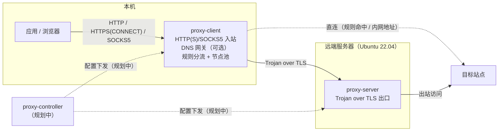

# Proxy

[](https://github.com/OopsOo0ps/proxy/actions/workflows/ci.yml)
[](go.mod)
[](LICENSE)

Proxy 是一个从零构建、面向 Ubuntu 22.04 的生产级正向代理工具：**客户端 / 服务端分离部署，控制端集中管理配置**，追求轻量、干净、长期可演进。

当前版本已具备可用的代理核心：本机 HTTP/HTTPS 与 SOCKS5 入站、基于 Trojan（over TLS）的隧道出站（多节点轮询 + 主动健康检查摘除 / 自动加回 + 失败冷却转移）、域名分流（本地规则文件 / 远程 URL 动态加载）、可选 DNS 网关（remote DNS）、认证、结构化日志、Prometheus 指标与健康/状态端点。

## 架构



- 实线：数据流方向（请求逐级转发，响应沿原路返回）。
- 虚线：控制流方向；`proxy-controller` 仍为骨架，配置下发尚未实现。
- 代码依赖方向：`cmd/` → `internal/` → `pkg/`。

## 特性

已交付的代理核心：

| 能力 | 说明 |
| --- | --- |
| HTTP/HTTPS 入站 | 支持 `CONNECT` 隧道与绝对地址形式的 HTTP 请求转发 |
| SOCKS5 入站 | TCP `CONNECT`；用户名/密码认证可选（RFC 1928 / RFC 1929） |
| 隧道出站 | Trojan over TLS；出口节点轮询、主动健康检查（连续失败摘除 / 连续成功自动加回）、失败自动切换与冷却退避 |
| 连接池 | 上游隧道预热池：启动预热、请求领取，省去一次完整握手；空闲数与 TTL 可配，失效自动回退新建 |
| 优雅关闭 | SIGTERM/SIGINT 后停止接受新连接，存量请求排空后退出；超过 `timeouts.shutdown`（默认 15s）强制断开剩余连接 |
| 背压（过载保护） | 进程级并发连接上限（默认 1024，0 = 不限制）；超限返回明确错误：HTTP 503 / SOCKS5 失败回复 / 隧道直接关闭，并计入 `connections_rejected_total` |
| 分流 | 规则文件驱动 direct / proxy；环回与私网地址默认直连 |
| 规则集动态加载 | 规则源二选一：本地 `rules_file` 或远程 `rules_url`；远程规则启动拉取、按周期刷新（缺省 30m），内容变化原子生效（新连接），拉取失败保持现有规则继续服务（见「规则集动态加载」） |
| DNS 处理 | **remote DNS（默认）**：代理名字不在本机解析，域名随隧道到出口解析（防污染 / 防泄漏 / CDN 按出口就近）；**可选 DNS 网关**：本机环回 UDP/TCP 监听，把“先查 DNS”的应用查询按同一分流规则转发（代理名字经出口远程解析，直连名字走本机解析器）。详见「DNS 处理策略」 |
| 认证 | 入站用户名密码 + 隧道口令；失败响应不泄露任何内部信息 |
| 日志 | `log/slog` 结构化 JSON，含 `request_id`、`client_ip`、`upstream`、`duration` |
| 动态日志级别 | 运维端点 `GET/PUT /log/level` 运行时切换 debug/info/warn/error，无需重启 |
| 配置热加载 | `SIGHUP` 重新加载配置文件：先校验、后原子切换；失败保持旧配置继续服务（见「配置热加载」） |
| 指标 | `/metrics` 暴露 `requests_total`、`request_duration_seconds`、`active_connections` |
| 健康检查 | `/health` 存活与依赖检查；依赖不可用时返回 503（`proxy-client` 检查出口节点池：全部节点被摘除或处于冷却时不可用；`proxy-server` 检查 TLS 证书有效期） |
| 运行时状态 | `/stats` 运行时快照：活跃连接数、出口节点状态（健康 / 摘除 / 连续失败 / 冷却剩余）、内存占用 |

规划中：控制端动态配置、systemd / 发行包、UDP 与 TUN 支持（见「限制说明」与「路线图」）。

## 快速开始

环境要求：Go 1.25+（仅构建需要）；生产运行目标为 Ubuntu 22.04。

```sh
git clone https://github.com/OopsOo0ps/proxy.git
cd proxy
make build
./bin/proxy-server -version
```

### 本地三节点演示

仓库自带一套本机演示配置（3 个出口节点 + 1 个客户端），可直接验证完整链路：

```sh
make dev-cert    # 生成本地自签证书到 var/

./bin/proxy-server -config configs/local/server-1.yaml &
./bin/proxy-server -config configs/local/server-2.yaml &
./bin/proxy-server -config configs/local/server-3.yaml &
./bin/proxy-client -config configs/local/client.yaml &

# HTTP/HTTPS 入站（浏览器同款 CONNECT 隧道）
curl -x http://127.0.0.1:18080 -U alice:change-me https://example.com

# SOCKS5 入站
curl --socks5-hostname 127.0.0.1:11080 -U alice:change-me https://example.com

# DNS 网关（演示配置已启用；代理名字经出口节点远程解析）
dig @127.0.0.1 -p 1053 +short example.com
dig @127.0.0.1 -p 1053 +tcp +short example.com   # 同一网关的 TCP 路径

# Prometheus 指标
curl -s http://127.0.0.1:19100/metrics | grep -E 'requests_total|request_duration_seconds|active_connections'
```

补充观察点：

- 不带 `-U` 访问会收到 `407 Proxy Authentication Required`（认证失败不带任何内部信息）。
- 直接访问节点 `https://127.0.0.1:18443` 会看到一张中性的伪装网页（不暴露代理存在）。
- 客户端日志（`configs/local/client.yaml` 中 `format: json`）包含逐请求的
  `request_id`、`client_ip`、`upstream`、`duration` 字段。
- 客户端默认会为每个节点预热空闲隧道（每节点 2 条），可在 `/metrics` 中通过
  `upstream_pool_*` 指标观察预热与领取情况。
- 上游故障自愈：停掉任一 `proxy-server` 进程后，客户端的主动健康检查会在连续
  失败若干个周期后摘除该节点（warn 日志 `exit node removed by active health check`，
  `/stats` 中 `removed: true`），流量继续由其余节点承载；重启该节点后连续探测成功
  即自动加回（info 日志 `exit node rejoined after passing health checks`）。
- DNS 查询走哪个节点、解析耗时多少，见客户端日志的 `dns query completed`
  记录；`/metrics` 的 `dns_queries_total` 按 `route`（direct / proxy）统计。

### 生产部署（示意）

```sh
# 服务端（远端出口）
./bin/proxy-server -config configs/example-server.yaml

# 客户端（本机入口）
./bin/proxy-client -config configs/example-client.yaml
```

### Docker 镜像

多阶段构建，按二进制拆分为独立镜像（linux/amd64，目标平台 Ubuntu 22.04）：

| 目标 | 镜像 | 说明 |
| --- | --- | --- |
| `client` / `server` | `proxy-client:dev` / `proxy-server:dev` | 最小运行镜像：distroless/static、非 root、无 shell（**< 30MB**） |
| `client-debug` / `server-debug` | `proxy-client-debug:dev` / `proxy-server-debug:dev` | 排错镜像：alpine + curl / dig / tcpdump / ss / nc / openssl / bash / jq（root） |

```sh
make docker-build          # 构建最小镜像（可 DOCKER_TAG=v0.1.0 指定标签）
make docker-build-debug    # 构建排错镜像

# 运行（配置与证书以卷挂载；镜像内自带 configs/example-*.yaml 作为模板）
docker run -d --name proxy-server \
  -v /etc/proxy/server.yaml:/etc/proxy/server.yaml:ro \
  -v /etc/proxy/tls:/etc/proxy/tls:ro \
  -p 8443:8443 \
  proxy-server:dev

docker run -d --name proxy-client \
  -v /etc/proxy/client.yaml:/etc/proxy/client.yaml:ro \
  -p 8080:8080 -p 1080:1080 \
  proxy-client:dev

# 排错镜像：除同一二进制外，另带网络排查工具（dig / tcpdump / ss / nc 等），以 root 运行
docker run --rm proxy-client-debug -version
```

说明：镜像仅构建 **linux/amd64**（与目标平台一致）；在 Apple Silicon 的
Docker Desktop 上可经 Rosetta 仿真运行（功能验证可用，性能非原生）。
CI 会构建两个最小镜像并校验 < 30MB，同时做冒烟（版本输出、排错镜像工具齐全）。

## 配置

配置为 YAML 且严格解析：**未知字段会直接导致启动失败**，避免拼写错误被静默忽略。
完整字段见 `configs/` 目录中的示例，以下为核心字段总览。

### 客户端 `proxy-client`

```yaml
inbound:
  http: "127.0.0.1:8080"    # HTTP/HTTPS 入站（CONNECT + 绝对地址请求）
  socks5: "127.0.0.1:1080"  # SOCKS5 入站（TCP CONNECT）
  auth:                     # 入站认证；监听非环回地址时必填
    - username: alice
      password: change-me

nodes:                      # 出口节点（Trojan over TLS），建议 ≥3
  - addr: "node1.example.com:443"
    password: node1-token
    sni: www.example.com    # 可选：TLS SNI / 证书校验名
  - addr: "node2.example.com:443"
    password: node2-token
  - addr: "node3.example.com:443"
    password: node3-token

pool:                       # 上游空闲隧道连接池（预热复用）
  max_idle: 2               # 每节点最大空闲连接数；0 = 关闭
  idle_ttl: 5s              # 空闲连接最长保留时间；应小于服务端 handshake 超时

health_check:               # 出口节点主动健康检查（故障自愈）
  interval: 10s             # 探测周期（TCP+TLS 握手，不发 Trojan 请求）；0 = 关闭
  timeout: 3s               # 单次探测超时
  failures: 3               # 连续失败 N 次后摘除该节点
  successes: 2              # 摘除后连续成功 M 次自动加回

limits:                     # 过载保护
  max_connections: 1024     # 进程级并发连接上限（HTTP + SOCKS5 合计）；0 = 不限制

tls:
  ca_file: ""                 # 自签证书时填写 CA 路径
  insecure_skip_verify: false # 仅调试：跳过证书校验

routing:
  default: proxy               # direct | proxy
  rules_file: ""               # 本地规则文件（与 rules_url 二选一），例如 configs/example-rules.yaml
  rules_url: ""                # 远程规则 URL（http/https，与 rules_file 二选一）
  rules_refresh_interval: 30m  # 远程规则刷新周期（缺省 30m；0 = 仅启动拉取一次）
  private_direct: true         # 环回 / 私网 / 链路本地目标一律直连

dns:                    # 可选 DNS 网关；listen 为空 = 关闭（见「DNS 处理策略」）
  listen: ""            # 例如 "127.0.0.1:53"；仅允许环回地址
  remote: "1.1.1.1:53"  # 代理名字的远程解析器（经出口节点，DNS over TCP）
  local: []             # 直连名字的解析器；留空 = 启动时读取 /etc/resolv.conf
  timeout: 5s           # 单次查询超时

timeouts: { dial: 10s, handshake: 10s, idle: 90s, shutdown: 15s }
metrics:  { listen: "127.0.0.1:9100" } # 指标与运维端点（/metrics、/health、/stats）
log:      { level: info, format: json }   # json | text
```

入口校验：监听非环回地址时必须配置 `inbound.auth`，否则启动直接报错。

#### 上游连接池（预热复用）

`proxy-client` 会为每个出口节点预热 `pool.max_idle` 条“已完成 TLS 握手、尚未发送请求”
的空闲隧道连接；请求到来时直接领取并补发 Trojan 请求，省去一次到节点的完整握手往返。

- 领取时做非阻塞存活探测（检查内核接收队列中的数据与关闭事件）：服务端已关闭、
  或已按握手超时回收的连接会被丢弃并回退新建，失效领取不计入节点失败，不影响
  既有的冷却与故障切换；
- 空闲超过 `pool.idle_ttl` 的连接会被回收；请保持该值明显小于服务端
  `timeouts.handshake`（默认 10s），否则连接可能在池中已被服务端回收——探测只能
  识别已经到达的失效信号，仍存在「领取瞬间与服务端回放擦肩」的小窗口；
- 预热采用“启动预热 + 领取后按需补齐”，空闲期不产生周期性握手流量；
- 节点被主动健康检查摘除时，其空闲预热连接会被立即清理并暂停补池；节点加回后
  随流量自动恢复预热；
- 预热拨号失败只计数与记录 debug 日志，不参与节点健康判定（节点健康由主动探测
  与真实拨号共同维护，见「健康检查与运行时状态」）。

### 优雅关闭（graceful shutdown）

`proxy-client` 与 `proxy-server` 收到 `SIGTERM` / `SIGINT` 后按两阶段退出：

1. **停止接受**：立即关闭入站监听，新连接被拒绝（不再有新请求进入）；
2. **排空存量**：已在途的请求 / 隧道继续完成，不受关停影响，最长等待
   `timeouts.shutdown`（默认 15s）；
3. **超时退出**：期限用尽后强制断开仍未结束的连接，记录 warn 日志后退出（退出码 0）。

两类“没有在途数据”的连接会在关停一开始就被立即关闭，避免拖满关停期限：

- 客户端：上游连接池中的空闲（已握手、未发送请求）隧道；
- 服务端：握手期、尚未读到完整请求的连接（主要是客户端连接池的预热连接）。

排空完成后日志出现 `shutdown: all in-flight connections drained`；超时强制断开时
出现 `shutdown: timeout exceeded, remaining connections closed`。

### 过载保护（背压）

- `limits.max_connections`（默认 1024，0 = 不限制）是**进程级**并发连接上限：
  `proxy-client` 统计 HTTP + SOCKS5 入站连接之和；`proxy-server` 统计隧道连接。
- 超限时的明确错误：
  - HTTP 入站：回 `503 Service Unavailable`（固定文案 + `Retry-After: 1`）；
  - SOCKS5 入站：回 `0x05 0xFF`（认证前协议没有专门的过载码，这是客户端可感知的失败）；
  - 隧道侧：直接关闭连接（TLS 层无法携带错误语义），并按秒限频记录 warn 日志。
- 读写超时：握手阶段由 `timeouts.handshake`、转发阶段由 `timeouts.idle` 约束
  （读与写均设期限）；拒绝响应的写出也有 2s 期限，慢客户端不会长期占用上限名额。
- 观测：`connections_rejected_total{proto}` 记录拒绝数；`/stats` 的 `limit` 字段
  展示上限、当前占用与累计拒绝。指标与运维端点不受连接上限影响（过载时仍可观测）。

### 服务端 `proxy-server`

```yaml
listen: "0.0.0.0:8443"       # Trojan over TLS 隧道
tls: { cert_file: server.crt, key_file: server.key }
users:                       # 每个客户端分配独立凭据
  - { username: alice, password: change-me-alice }
decoy_file: ""               # 可选：认证失败时的伪装页面
limits: { max_connections: 1024 }  # 进程级并发隧道上限；0 = 不限制
timeouts: { dial: 10s, handshake: 10s, idle: 90s, shutdown: 15s }
metrics:  { listen: "127.0.0.1:9200" } # 指标与运维端点（/metrics、/health、/stats）
log:      { level: info, format: json }
```

### 分流规则 `rules_file`

```yaml
default: proxy   # 未命中任何规则时：direct | proxy
rules:
  - action: direct
    match:
      - "localhost"        # 精确域名
      - "*.example.com"    # 通配子域名（不匹配裸域）
      - "1.2.3.4"          # 精确 IP
      - "192.168.0.0/16"   # CIDR 网段（IPv6 同样支持）
  - action: proxy
    match: ["*.google.com"]
```

- 规则自上而下匹配，**先命中者生效**；规则文件的 `default` 优先于客户端配置。
- 内置安全行为：环回、私网（RFC 1918 / ULA）、链路本地、组播地址与 `localhost`
  在 `private_direct: true`（默认）时一律直连，避免把内网流量误发到远端。

### 规则集动态加载（远程规则）

除本地规则文件外，规则也可以从 URL 拉取并按周期刷新（两个来源**二选一**，
同时配置会直接报错）：

```yaml
routing:
  default: proxy
  rules_url: "https://rules.example.com/proxy-rules.yaml"  # 仅允许 http / https
  rules_refresh_interval: 30m   # 刷新周期（缺省 30m）；0 = 仅启动拉取一次
```

- 启动时同步拉取一次；**拉取失败不阻止启动**：告警后以空规则（仅默认动作与
  内置直连行为）继续运行，后续刷新周期会自动重试（`rules_refresh_interval: 0`
  时可发 SIGHUP 或重启重试）；
- 运行期按周期重新拉取：内容与上次成功加载完全一致时不做任何重建；有变化时
  重新解析、校验、编译后**原子替换**——生效边界为“新连接”，与配置热加载一致；
- 规则变化（含 SIGHUP 重拉）会同时丢弃**转发路径**（绝对地址 HTTP 请求）的空闲
  上游连接，避免后续请求复用到旧路由建立的连接；在途请求不受影响，新请求按
  新规则重新建连（CONNECT 隧道本就每次请求新建，不受影响）；
- **失败不炸线上**：拉取失败（网络 / 非 2xx / 超时）、内容非法（YAML / 未知字段 /
  匹配项校验失败）或超过大小上限时，保持现有规则继续服务，并计入
  `ruleset_refreshes_total{result="error"}`、日志 warn（`ruleset: refresh failed; …`）；
- 约束：仅 `http` / `https`；单次拉取超时 15s；响应体上限 8 MiB；规则内容与
  本地文件同款严格解析（未知字段报错）；不支持自定义请求头与认证；
- SIGHUP 热加载会对远程规则立即重拉一次：成功时新内容立即生效；失败只告警并
  保持现有规则（容错语义，不影响本次重载的其余变更）。本地规则文件仍是严格
  语义：读取 / 解析失败会拒绝整次重载。

`/stats` 的 `ruleset` 字段（仅配置了规则源时输出）与下方指标可直接观察规则源状态：

```sh
curl -s http://127.0.0.1:9100/stats | python3 -m json.tool | grep -A8 ruleset
# "ruleset": {
#   "source": "url",
#   "target": "https://rules.example.com/proxy-rules.yaml",
#   "refresh_seconds": 1800,
#   "loaded": true,
#   "rules": 12,
#   "last_success": "2026-10-10T12:00:00Z"
# }
```

本机演示（远程规则按周期自动生效）：

```sh
# 1) 用任意静态服务器托管规则文件，例如：
mkdir -p /tmp/rules && cp configs/example-rules.yaml /tmp/rules/rules.yaml
python3 -m http.server 18081 -d /tmp/rules &

# 2) 客户端配置：
#    routing:
#      rules_url: "http://127.0.0.1:18081/rules.yaml"
#      rules_refresh_interval: 10s

# 3) 修改 /tmp/rules/rules.yaml（例如把某条规则的 action 从 proxy 改为 direct），
#    等一个刷新周期后新连接即按新规则分流；/metrics 中 ruleset_refreshes_total 增长。
```

### DNS 处理策略

代理的 DNS 问题决定了“域名在哪里被解析”。本项目的策略是 **remote DNS 优先**：

**1）默认（零配置）：域名随隧道到出口解析。** 应用把域名交给代理——浏览器与
大多数客户端经 HTTP `CONNECT`，`curl --socks5-hostname` / `socks5h://` 经
SOCKS5 域名模式——`proxy-client` 不解析域名，而是把域名原样写入 Trojan 请求，
由 `proxy-server` 在出口解析并连接。由此同时得到：

- **防污染**：本机网络中的 DNS 劫持不参与代理路径；
- **防泄漏**：代理目标域名不出现在本机的 DNS 查询里；
- **CDN 按出口就近**：解析结果来自出口侧网络。

反面提示：`curl --socks5`（本地先解析、再把 IP 交给代理）或任何“应用自行解析后
连 IP”的流程，会让代理只看到 IP——域名分流与远程解析都会失效。请使用
`socks5h` / `--socks5-hostname`，或把解析交给下面的 DNS 网关。

**2）可选：本机 DNS 网关（`dns.listen`）。** 面向“先查 DNS 再连接”的应用与
系统级解析：把它们的解析器指向本网关后，查询按**与流量一致的同一套分流规则**
分派：

- 命中 `proxy` 的名字：经出口节点远程解析（DNS over TCP 走 Trojan 隧道，
  由出口侧访问 `dns.remote` 指定的解析器）；
- 命中 `direct` 的名字（含 `localhost` 与私网规则等）：转发给 `dns.local`
  配置的本机解析器（缺省读取 `/etc/resolv.conf`，自动排除网关自身）。

```yaml
dns:
  listen: "127.0.0.1:53"   # 仅允许环回地址；53 端口需要 root 或 CAP_NET_BIND_SERVICE
  remote: "1.1.1.1:53"     # 应选择从出口可达、支持 TCP 的解析器（例：223.5.5.5:53、
                           # 或出口本机 stub，如 127.0.0.53:53 / 100.100.2.136:53）
  local: []                # 直连名字的解析器；留空 = 读取 /etc/resolv.conf
  timeout: 5s              # 单次查询（含隧道往返）超时
```

在 Ubuntu 22.04 上把系统解析器指向网关（二选一）：

```sh
# 方式一：systemd-resolved 将 DNS 请求转发给网关
sudo resolvectl dns <iface> 127.0.0.1:53

# 方式二：直接改写 /etc/resolv.conf（绕过 systemd-resolved）
printf 'nameserver 127.0.0.1\n' | sudo tee /etc/resolv.conf
```

注意：若把 `resolv.conf` 直接指向网关（端口 53），网关启动时读到的系统解析器
可能包含它自己（会被自动排除，并打 warn 日志）；此时请在 `dns.local` 里显式
配置直连用的解析器（如路由器的 `192.168.1.1:53`），否则直连名字将解析失败。

#### remote DNS 与 fake-IP 的取舍

| | 本地解析（direct 路径） | remote DNS（本项目默认） | fake-IP（暂未实现） |
| --- | --- | --- | --- |
| 解析位置 | 本机 | 出口侧 | 不解析，域名语义保留到出口 |
| 防 DNS 污染 / 泄漏 | 否 | 是（代理名字零本地查询） | 是 |
| CDN 就近 | 按本机位置 | 按出口位置 | 按出口位置 |
| 应用配合 | 无需 | 把域名交给代理（CONNECT / socks5h）或用 DNS 网关 | 连“先解析再连 IP”的应用也无感 |
| 兼容性 | 最好 | 好 | 差：IP 语义应用（SNI 取自 IP、IP 白名单、地理判断）会异常 |
| 实现前提 | — | 本仓库已具备 | 需要 fake IP 分配 + 反向映射，最佳体验依赖 TUN |

**为什么本期不做 fake-IP（路线图 3.1 中标记为可选）**：

- 它的核心收益是让“先解析再连 IP”的应用也获得域名语义；这部分应用改指向
  DNS 网关后可达到近似效果（查询经隧道远程解析，连接仍按域名/规则走）；
- fake-IP 会引入第二套地址语义：假地址（如 198.18.0.0/15）出现在目标、分流
  判断与日志里，都要反查回域名；以 IP 为前提的应用会出现难以解释的故障；
- 其最佳形态是配合 TUN / 透明代理（自动接管“连到假地址”的连接）；本项目
  暂不支持 TUN（见「限制说明」），在当前显式代理形态下收益有限。

**下一步条件**：引入 TUN 模式时，把 fake-IP 作为 `dns.mode` 的可选策略实现
（网关分配假地址，代理入站按假地址反查域名），并复用本节同一套分流语义。

### 配置热加载（SIGHUP）

`proxy-client` 与 `proxy-server` 支持不重启进程重新加载同一份配置文件：

```sh
kill -HUP "$(pidof proxy-client)"   # systemd: systemctl reload proxy-client
# systemd 单元中配置：ExecReload=/bin/kill -s HUP $MAINPID
```

语义（“配置错误不炸线上”）：

- **先构建、后切换**：收到 SIGHUP 后重新读取并严格解析、校验配置文件，构建出完整的
  新运行时（规则文件、证书、凭据、节点池）后才一次性生效。任一步失败——YAML 错误、
  未知字段、校验不通过、规则文件 / 证书文件读取失败——都会放弃本次重载并记录失败原因，
  进程保持旧配置继续服务。
- **原子生效**：生效边界为“新连接”——切换瞬间已在处理的请求 / 隧道继续使用旧配置，
  之后到达的连接使用新配置，不会出现半新半旧的状态。
- **拒绝无法原子完成的变更**：监听地址（`inbound.*`、`listen`、`metrics.listen`、`dns.listen`）
  属于进程启动时绑定的资源，变更会被明确拒绝并提示需要重启，旧配置保持不变。

热加载生效范围：

| 配置 | proxy-client | proxy-server |
| --- | --- | --- |
| 入站凭据 / 隧道用户 | ✅ `inbound.auth` | ✅ `users` |
| 出口节点与分流 | ✅ `nodes`、`routing.*`（含规则文件内容变化；远程规则立即重拉，失败保持现有规则） | — |
| 健康检查 | ✅ `health_check.*` | — |
| TLS | ✅ `tls.ca_file`、`tls.insecure_skip_verify` | ✅ `tls.cert_file` / `key_file`（证书轮换） |
| 连接池 / 超时 / 连接上限 | ✅ `pool.*`、`timeouts.*`、`limits.*` | ✅ `timeouts.*`、`limits.*` |
| 日志级别与格式 | ✅ `log.*` | ✅ `log.*` |
| 伪装页 | — | ✅ `decoy_file` |
| 监听地址 | ❌ 需重启 | ❌ 需重启 |

说明：

- 重载会重建受影响的运行时组件：出口节点、连接池或健康检查参数变化时，预热池与
  探测循环整体重建（旧空闲连接关闭、旧探测循环停止、按新配置重新预热与探测）；
  只改分流规则或凭据时不会抖动预热连接。
- 分流规则在重载时立即重新检查：本地规则文件严格重读（失败拒绝本次重载，
  保持旧配置原样服务）；远程规则立即重拉（失败只告警、保持现有规则继续服务，
  与周期刷新一致的容错语义）。若本次重载更换了规则源（路径 / URL / 刷新周期
  变化），则按与新启动相同的语义构建新来源：URL 首次拉取失败时告警并以空规则
  运行，等待后续刷新成功。
- 每次重载尝试都计入 `config_reloads_total{result}`；成功时日志输出
  `configuration reloaded`，失败时输出
  `config reload failed; keeping current configuration` 与具体原因。
- 重载以配置文件（及启动参数 `-log-level`）为准：会覆盖此前通过 `/log/level`
  做的运行期级别调整。

```sh
# 演示：把配置改错后（例如写入未知字段）再发 SIGHUP——进程保持旧配置继续服务，
# 日志给出原因；改对后再发 SIGHUP 即原子生效。
# {"level":"ERROR","msg":"config reload failed; keeping current configuration","error":"..."}
```

真机验证（2026-10-10，3 台阿里云 VPS 出口 + 本机客户端，全部流量经公网三节点）：
坏配置 SIGHUP 后旧配置持续服务；入站改密、节点口令与服务端 users 热重载均即时生效
（旧凭据被拒、新凭据可用）；监听地址变更被明确拒绝且服务不受影响；各轮 6/6 请求
成功，`config_reloads_total` 与日志按预期记录成功 / 失败。

## 观测

### 指标（Prometheus）

任一进程配置 `metrics.listen` 后即可访问 `GET /metrics`：

| 指标 | 类型 | 标签 | 含义 |
| --- | --- | --- | --- |
| `requests_total` | counter | `proto`、`route`、`result` | 代理请求总数（含失败分类） |
| `request_duration_seconds` | histogram | `proto`、`route` | 请求耗时（秒） |
| `active_connections` | gauge | `proto` | 当前活跃连接数 |
| `connections_rejected_total` | counter | `proto` | 因超过连接上限被拒绝的连接数 |
| `upstream_pool_claims_total` | counter | `node`、`result` | 空闲连接领取结果（`hit` / `miss` / `stale`） |
| `upstream_pool_idle_connections` | gauge | `node` | 各节点当前空闲（已握手待用）连接数 |
| `upstream_pool_warm_failures_total` | counter | `node` | 后台预热拨号失败次数 |
| `upstream_health_probes_total` | counter | `node`、`result` | 主动健康探测次数（`success` / `failure`） |
| `upstream_healthy` | gauge | `node` | 节点当前是否可接流量（1 = 可接，0 = 已被主动摘除） |
| `dns_queries_total` | counter | `route`、`result` | DNS 网关查询数（`route`：`direct` / `proxy` / `none`，`result`：`ok` / `error` / `invalid`） |
| `dns_query_duration_seconds` | histogram | `route` | DNS 网关查询耗时（秒），含隧道往返 |
| `config_reloads_total` | counter | `result` | 配置热加载尝试数（`success` / `error`） |
| `ruleset_refreshes_total` | counter | `result` | 规则集加载 / 刷新尝试数（`success` / `unchanged` / `error`，含启动首次加载） |
| `ruleset_last_success_timestamp_seconds` | gauge | — | 最近一次成功加载规则的时间戳（Unix 秒；从未成功时不输出） |
| `ruleset_rules` | gauge | — | 当前生效的规则条数 |

`proto` 取值 `http` / `socks5` / `tunnel`；`route` 取值 `direct` / `proxy`；
`result` 取值 `ok` / `auth_fail` / `dial_fail` / `error`。`ok` 包含**对端主动中止**：
连接拆除阶段的 TCP RST / EPIPE（浏览器读满响应后直接关闭、Linux 上 TLS 目标站点读完
`close_notify` 后关闭连接等内核行为）——此时转发通常已完整送达，错误详情保留在完成
日志的 `error` 字段，不单独计入 `error`。
`ruleset_*` 系列仅 `proxy-client` 配置了规则源（`routing.rules_file` 或
`routing.rules_url`）时产生数据。
`upstream_pool_*` 系列仅 `proxy-client` 输出：连接池默认开启（`pool.max_idle: 2`），
关闭后不产生这些序列；`upstream_health_probes_total` / `upstream_healthy` 在配置了
出口节点时输出（主动探测关闭后不再更新）。`dns_*` 系列仅 `proxy-client` 启用 DNS 网关后输出
（`route=none` 表示被拒绝 / 丢弃的非法查询，只计入 counter）。

```sh
curl -s http://127.0.0.1:19100/metrics | grep requests_total
```

生产环境请将 `metrics.listen` 绑定到环回地址或置于防火墙之后（`/health`、`/stats` 与 `/metrics` 同址暴露）。

### 健康检查与运行时状态

`/health`、`/stats` 与 `/metrics` 共用 `metrics.listen` 监听（未配置则同样不启用）：

```sh
curl -s http://127.0.0.1:9100/health
# {"status":"ok","uptime":12.34}

curl -s http://127.0.0.1:9100/stats
# {"version":"...","uptime":12.34,"connections":{"http":1,"total":1},
#  "upstreams":[{"addr":"node1:443","healthy":true,"fails":0,"cooldown_remaining":0,
#                "removed":false,"probe_fails":0,"idle":2}],
#  "ruleset":{"source":"url","target":"https://rules.example.com/proxy-rules.yaml",
#             "refresh_seconds":1800,"loaded":true,"rules":12,"last_success":"2026-10-10T12:00:00Z"},
#  "memory":{"alloc_bytes":...,"sys_bytes":...,"num_gc":...,"goroutines":...}}
```

- `GET /health`：进程存活时返回 `{"status":"ok","uptime":<秒>}`；依赖不可用时返回
  `503` 与 `{"status":"unavailable","reason":"..."}`。依赖定义：
  - `proxy-client`：配置了出口节点且没有任何可接流量的节点（全部被主动摘除或处于
    冷却中）时不可用；
  - `proxy-server`：TLS 证书在运行中过期时不可用。
- `GET /stats`：运行时快照，字段见上例。`upstreams` 仅 `proxy-client` 输出；
  `proxy-server` 的 `connections` 只统计隧道连接。`upstreams[].idle` 是当前空闲
  预热连接数（未启用连接池时为 0）；`removed` 表示是否被主动健康检查摘除，
  `probe_fails` 是当前连续探测失败次数。配置了连接上限时另有 `limit` 字段：
  上限、当前占用与累计拒绝数（0 = 不限制时不输出）。
- `ruleset`（仅配置了规则源时输出）：规则来源（`file` / `url`）、目标（文件路径或
  URL）、URL 刷新周期（秒，0 = 仅启动拉取一次）、是否已成功加载、当前规则条数、
  最近一次成功加载时间（RFC3339）与最近一次失败原因（成功后清空）；
  `loaded: false` 表示远程规则尚未成功拉取过（按空规则运行），见「规则集动态加载」。
- `/health`、`/stats` 只接受 `GET`（其它方法返回 405），与 `/metrics` 一样不做鉴权，
  请仅在环回地址或防火墙之后暴露；运行时日志级别端点 `/log/level` 见下节。

出口节点健康由两套机制共同维护，节点“可接流量 = 未被摘除 且 不在冷却中”：

- **主动健康检查**（`health_check`，默认开启）：按 `interval`（默认 10s）对每个节点
  做一次 TCP+TLS 握手探测——不发送 Trojan 请求、不占用预热连接池。连续失败
  `failures`（默认 3）次后**摘除**该节点：它不再参与任何新拨号（硬摘除），其空闲
  预热连接被立即清理；摘除后继续探测，连续成功 `successes`（默认 2）次**自动加回**
  并清空被动失败计数与冷却。摘除 / 加回分别记录 warn / info 日志；
  `interval: 0` 关闭主动探测。
- **被动冷却**：真实拨号失败后按指数退避冷却（10s 起、5m 封顶），冷却期跳过该节点；
  全部节点处于冷却（且均未被摘除）时仍会全量尝试，避免“有节点但永远不试”的黑洞。
- 探测只验证节点可达性与 TLS 握手，**不校验隧道口令**：口令错误、协议异常等隧道层
  问题仍由真实流量的被动冷却兜底；反之，真实拨号的成功 / 失败不改变摘除状态。

### 日志级别动态调整

`/log/level` 与 `/metrics`、`/health`、`/stats` 共用 `metrics.listen`，可在运行时切换
日志级别，无需重启（`-log-level` 与配置 `log.level` 仍决定启动级别）：

```sh
curl -s http://127.0.0.1:9100/log/level
# {"level":"info"}

curl -s -X PUT "http://127.0.0.1:9100/log/level?level=debug"
# {"level":"debug","previous":"info"}
```

- 支持 `debug` / `info` / `warn` / `error` 四档（大小写不敏感）；非法级别返回 400。
- 仅接受 `GET`（查询）与 `PUT`（切换），其它方法返回 405。
- 每次切换会**先**以 info 记录一条 `log level changed` 再生效，因此即使切到 error
  也留有变更凭证。
- 与其它运维端点一样不做鉴权，请仅在环回地址或防火墙之后暴露。

### 日志

基于标准库 `log/slog`，默认结构化 JSON（`format: text` 可切换为文本）。每条请求完成日志包含：

| 字段 | 说明 |
| --- | --- |
| `request_id` | 16 位十六进制随机关联 ID（crypto/rand） |
| `client_ip` | 来源地址 |
| `upstream` | 命中的出口节点地址；直连为 `direct`，连接池复用为 `pool` |
| `duration` / `duration_ms` | 可读耗时与毫秒数 |
| `error` | 收尾错误的详情与来源标注（`client:` 入站侧 / `upstream:` 出站侧，如 `client: read tcp ...: connection reset by peer`）；正常结束时省略 |
| 其他 | `proto`、`target`、`route`、`result`、`bytes_up`、`bytes_down`、`user`（服务端）等 |

示例（客户端）：

```json
{"time":"...","level":"INFO","msg":"request completed","request_id":"8ea7571e7f8ede6b","proto":"http","client_ip":"127.0.0.1","method":"CONNECT","target":"example.com:443","route":"proxy","upstream":"127.0.0.1:18443","duration":"1.438054s","duration_ms":1438,"bytes_up":585,"bytes_down":4876,"result":"ok"}
```

## 安全

- 入站代理支持用户名/密码认证（HTTP `Proxy-Authorization` / SOCKS5 RFC 1929）；
  监听非环回地址时**强制**要求认证。
- 隧道凭据以 SHA-224 摘要形式在 TLS 内传输；服务端凭据存储只保留摘要，
  比较全部使用常量时间实现，避免时序侧信道。
- 失败响应不泄露信息：入站统一回标准 407 / SOCKS5 通用失败码（固定文案）；
  隧道层对认证失败与非协议流量返回中性伪装网页（可用 `decoy_file` 自定义），
  与普通 Web 服务无法区分。
- 出口节点证书校验默认开启；`insecure_skip_verify` 仅供自签调试，请勿在生产使用。

## 限制说明

- **暂不支持 UDP**：SOCKS5 的 `UDP ASSOCIATE` 与 Trojan 的 UDP 转发均未实现，
  当前仅代理 TCP（返回标准「命令不支持」响应并在日志中记录）。
- **暂不支持 TUN**：没有全局透明代理/虚拟网卡模式，仅提供 HTTP/HTTPS 与 SOCKS5 入站，
  未配置代理的程序不会被自动接管。
- **DNS 网关的边界**：仅监听环回地址（避免成为开放解析器，非环回配置直接拒绝启动）；
  只处理标准单问题查询，其余回 FORMERR / REFUSED；无缓存，每次查询独立经隧道
  往返（受益于上游连接池预热但无查询级复用）；UDP 客户端查询在网关内转为
  TCP DNS（要求 `dns.remote` 支持 TCP——公共解析器均支持）。
- **remote DNS 的前提**：仅在应用把域名交给代理（CONNECT / `socks5h`）或经
  DNS 网关解析时成立；应用若自行解析后连接 IP，代理只能看到 IP，域名分流与
  防污染均不适用。
- **出口侧解析器**：由 `proxy-server` 的系统 `resolv.conf` 决定；如需指定出口
  解析器，属于后续迭代（当前可把 `dns.remote` 指向任意从出口可达的解析器，
  从客户端侧达成目的）。
- **连接池的边界**：预热连接会在服务端占用同数量的“待用连接”，并非永远有效——
  空闲超过服务端 `timeouts.handshake` 的连接会被服务端回收；客户端领取时做非阻塞
  存活探测（直接检查内核接收队列中的数据与关闭事件，不受协程调度影响），把已失效
  连接丢弃并回退新建。请保持 `pool.idle_ttl`（默认 5s）明显小于服务端握手超时
  （默认 10s）：探测只能看到已经到达的失效信号，连接若在池中就被回收，仍存在
  「领取瞬间与服务端回放擦肩」的小窗口；节点不可达时预热会失败并计入
  `upstream_pool_warm_failures_total`。
- **主动健康检查的边界**：探测只验证 TCP+TLS 可达性，不发送 Trojan 请求、不校验
  隧道口令——口令错误、协议异常等隧道层问题由真实流量的被动冷却兜底；摘除判定按
  探测周期累计（默认 10s × 连续 3 次失败，最坏约 30s 后摘除），判定完成前的少量
  请求仍可能失败；全部节点被摘除时拨号快速失败、不再降级尝试，等待探测恢复自动加回。
- **配置热加载的边界**：监听地址变更需要重启（热加载明确拒绝并提示）；重载会重建
  出口节点池与预热连接池（当 `nodes`、`pool`、`health_check`、`tls`、`timeouts`
  变化时），节点冷却与摘除状态随之重置；运行期通过 `/log/level` 做的级别调整会被
  重载后的文件（或启动参数）值覆盖。
- **收尾中止不可区分**：TCP RST / EPIPE 既可能是收尾竞态（数据已完整送达），也可能
  是传输中途被截断——relay 层看不到应用语义，两者都按正常收尾计入 `result=ok`；
  唯一的区分途径是完成日志的 `error` 字段（含 `client` / `upstream` 来源标注）。
- **远程规则（`rules_url`）的边界**：不含本地缓存——进程重启后若首次拉取失败，
  会以空规则（仅默认动作与内置直连行为）继续运行，直到某次刷新或 SIGHUP 重拉
  成功；仅支持单一规则源（本地文件与远程 URL 二选一，不支持多 URL 合并）；
  拉取为同步 HTTP（15s 超时、8 MiB 上限、仅 http/https），不支持自定义请求头 /
  认证；变更检测基于内容摘要——远端语义相同但字节不同也会触发一次重建（无害）。
- `proxy-controller` 仍为骨架，配置尚不支持集中下发；请手动分发配置文件。
- 生产运行目标平台为 Ubuntu 22.04；其他平台尚未验证。
- 尚未提供 systemd 单元与发行包，请通过源码构建使用。
- 关停期间不接受新连接；超过 `timeouts.shutdown` 仍未结束的连接会被强制断开
  （日志中有明确记录），这是有意的“有限期 drain”语义。
- 连接上限语义：客户端统计 HTTP + SOCKS5 入站合计，服务端统计隧道连接。
  隧道侧超限只能直接关闭连接（TLS / Trojan 都没有错误码通道），客户端表现为
  拨号失败并可能触发节点切换；另外客户端连接池的预热连接同样占用服务端名额，
  服务端上限应大于「客户端数 × `pool.max_idle` + 真实并发」。

## 基准测试

性能相关数字均有 `go test -bench` 实测依据。基准只在**本机回环 / 内存管道**上运行，
用于追踪热路径固定开销与回归，**不代表公网吞吐**，也不做跨软件对比。

测试条件（2026-10-10，Go 1.25.0）：

- 本机：Apple M4 / darwin arm64；
- 目标平台对照：Ubuntu 22.04.5 / Intel Xeon Platinum 2 vCPU（阿里云 VPS，测试二进制
  交叉编译后在该机执行）。

命令（本机；VPS 用 `go test -c` 交叉编译后以 `-test.bench=. -test.benchmem -test.count=3` 执行）：

```sh
go test -bench=. -benchmem -run='^$' -count=3 ./internal/...
```

以下为 `-count=3` 的中位数（B/op、allocs/op 与平台无关，取共同值）：

| 基准 | 度量对象 | 本机 M4 | VPS（Ubuntu 22.04） |
| --- | --- | --- | --- |
| `BenchmarkConnectHandshake` | CONNECT 入站握手（建连 → 200，上游为内存管道） | 72.5µs，18.7KB，96 allocs | 226µs，18.4KB，96 allocs |
| `BenchmarkCopyLoopPooled` | 转发循环搬运 1MiB（`sync.Pool` 缓冲） | 71µs（≈14.7GB/s），0 allocs | 258µs（≈4.05GB/s），0 allocs |
| `BenchmarkCopyLoopUnpooled` | 对照：每次新建 32KiB 缓冲 | 72µs，32.8KB，1 alloc | 280µs，32.8KB，1 alloc |
| `BenchmarkClaimHit` | 空闲隧道领取（含 1ms 存活探测窗口） | 1.15ms，6 allocs | 1.11ms，6 allocs |
| `BenchmarkDecide/direct-rule` | 命中直连规则（域名 / 通配 / 网段） | 41ns，48B，1 alloc | 164ns，48B，1 alloc |
| `BenchmarkDecide/private-direct` | 私网目标内建直连 | 26ns，0 allocs | 92ns，0 allocs |
| `BenchmarkDecide/proxy-rule` | 命中通配代理规则 | 77ns，144B，3 allocs | 384ns，144B，3 allocs |
| `BenchmarkDecide/default` | 未命中回落默认动作 | 79ns，144B，3 allocs | 367ns，144B，3 allocs |
| `BenchmarkStoreVerify/hit` | 入站凭据校验（16 用户，常量时间比较） | 69.8ns，0 allocs | 400ns，0 allocs |
| `BenchmarkStoreVerify/miss` | 未知用户（同样走常量时间路径） | 61.1ns，0 allocs | 396ns，0 allocs |

解读与边界：

- `ConnectHandshake` 的上游是内存管道，度量代理自身处理（解析、拨号调用、200 写出），
  不含真实网络往返；每次迭代会新建一条本机 TCP 连接。
- 转发循环用内存管道而非 TCP：度量代码路径与分配，不测内核网络栈；`Pooled` 与
  `Unpooled` 的分配差异即缓冲复用的效果（与 2.4 记录一致）。
- `ClaimHit` 的固定开销主要是 1ms 存活探测窗口，两台机器基本一致（与 2.3 记录一致），
  说明该路径受计时窗口而非 CPU 限制。
- 分流与凭据校验是纯 CPU 路径：小核 VPS 约为 M4 的 3–5 倍耗时，分配次数与平台无关。
- 数字为小样本中位数，随机器与负载波动，不构成 SLA。

## 项目结构

```text
├── cmd/                  # 可执行入口（三个独立二进制）
│   ├── server/           #   proxy-server（远端出口）
│   ├── client/           #   proxy-client（本机入口）
│   └── controller/       #   proxy-controller（骨架）
├── configs/              # 示例配置（生产模板 + 本地三节点演示）
├── internal/
│   ├── auth/             #   凭据存储与常量时间校验
│   ├── clientapp/        #   proxy-client 组装与端到端测试
│   ├── config/           #   配置解析、默认值与校验
│   ├── dialer/           #   路由感知的出站拨号
│   ├── dnsgw/            #   可选 DNS 网关（分流感知的 DNS 转发）
│   ├── httpproxy/        #   HTTP/HTTPS 入站（CONNECT + 转发）
│   ├── logging/          #   slog 初始化、request_id 与运行期级别/格式切换
│   ├── metrics/          #   Prometheus 指标
│   ├── netutil/          #   网络小工具
│   ├── nodes/            #   出口节点池（轮询/冷却/切换）
│   ├── relay/            #   双向转发（半关闭/空闲超时）
│   ├── routing/          #   分流规则引擎
│   ├── ruleset/          #   规则源（本地文件 / 远程 URL）与定时刷新
│   ├── serverapp/        #   proxy-server 组装
│   ├── socks5/           #   SOCKS5 入站与地址编码
│   ├── testutil/         #   测试辅助（自签证书）
│   └── trojan/           #   Trojan 协议（客户端握手 / 服务端）
├── pkg/version/          #   版本信息（构建期注入）
├── test/integration/     #   黑盒集成测试（真实二进制端到端）
├── Dockerfile            # 容器镜像（多阶段：最小版 / 排错版，linux/amd64）
├── Makefile              # 开发入口（build / test / cover / lint ...）
└── .github/workflows/    # CI（构建 + 测试 + golangci-lint）
```

## 开发

- `make build`：构建三个二进制到 `bin/`（自动注入版本信息）
- `make test`：运行全部单元测试（含端到端用例）
- `make cover`：运行测试并打印总覆盖率
- `make lint`：静态检查（golangci-lint v2，首次自动下载）
- `make dev-cert`：生成本地演示用自签证书

端到端测试使用本机回环与自签证书，覆盖：CONNECT 转发成功率（100 次请求，
验收线 ≥95%）、三节点轮询、节点故障转移、主动健康检查摘除 / 加回（含空闲预热
连接清理与热加载生效）、连接池预热与领取命中、私网直连、
优雅关停排空（存量请求不被中断、新连接被拒绝）、过载保护（超限拒绝与恢复）、
SOCKS5 与入站认证、DNS 网关（代理名字经出口远程解析且本地解析器零触达、
直连名字走本机解析器、TC 截断回退 TCP、非法查询拒绝）、指标暴露与日志字段。
配置热加载同样有端到端覆盖：坏配置重载后旧配置继续服务、凭据与出口节点热替换、
证书轮换、健康检查参数热切换、监听地址变更被拒绝、成功 / 失败计数进入
`config_reloads_total`。
规则集动态加载也有端到端覆盖：远程规则按周期刷新生效（路由翻转）、非法内容与
拉取失败保持旧规则并在源恢复后自动收敛、启动拉取失败告警后继续运行、SIGHUP
立即重拉（失败容错）、`ruleset_refreshes_total` 与 `/stats` 的 `ruleset` 字段按预期记录。

集成测试（`test/integration/`，随 `make test` 运行，`-short` 跳过）以**黑盒**方式
验证交付物本身：`go test` 时构建并启动真实的 `proxy-server` / `proxy-client`
二进制，端口全部动态分配（配置写 `:0`，从启动日志读取实际地址）。链路为
「启动服务 → 发请求（HTTP 转发 / HTTPS CONNECT / SOCKS5 / 原始 CONNECT）→
验证分流（客户端指标 `route` 标签、结构化日志的 `route`/`upstream`/`target`、
服务端成功隧道计数）→ 验证指标（`/metrics` 的 `requests_total`、
`request_duration_seconds`、`active_connections`）→ SIGTERM 优雅关停（退出码 0）」；
其中 SOCKS5 与 CONNECT 请求要求「读到 EOF」，覆盖目标先关闭时半关闭沿
入站 → 隧道 → 出口逐层传播。全程不依赖外部网络。

混沌用例（`test/integration/chaos_test.go`，同随 `make test` 运行）对真实二进制
做故障注入：SIGKILL 一个上游节点进程后，验证主动健康检查的自动摘除（`/stats`
`removed:true`、warn 日志、`upstream_healthy` 指标）、窗口期与摘除后的请求
全部由剩余节点承载（0 失败、不再拨号被摘除节点），以及同址重启后的自动加回
与流量重新分布。另在 3 台阿里云 VPS 上完成真机演练（默认健康检查参数
10s/3s/3/2）：SIGKILL 上游后 22.5s 摘除、14.7s 自动加回，全程 140 次请求
0 失败，出口 IP 分布与预期逐阶段吻合。
CI 与本地使用同一套 Makefile 目标，行为一致。

## 路线图

- [x] 仓库基础：布局 / Makefile / CI / 文档
- [x] HTTP / HTTPS 正向代理核心（CONNECT + 绝对地址转发）
- [x] SOCKS5 入站（TCP CONNECT + 可选认证）
- [x] 客户端 ↔ 服务端隧道（Trojan over TLS，多节点）
- [x] 基础域名分流与内网直连
- [x] 认证、结构化日志、Prometheus 指标
- [x] 连接池（上游隧道预热复用）与转发缓冲复用（`sync.Pool`）
- [x] 优雅关闭（drain）与背压（连接上限 + 明确错误）
- [x] 热路径基准测试（本机 + Ubuntu 22.04 对照）
- [x] 动态日志级别（`/log/level` 运行时切换）
- [x] DNS 处理策略（remote DNS 默认 + 可选 DNS 网关；fake-IP 权衡与下一步条件记录）
- [x] 配置热加载（SIGHUP：校验失败保持旧配置，成功原子生效）
- [x] 上游故障自愈（主动健康检查：连续失败摘除、连续成功自动加回；被动冷却转移）
- [x] 规则集动态加载（远程 URL 拉取 + 定时刷新；失败保持现有规则，SIGHUP 立即重拉）
- [x] 集成测试（黑盒：构建并启动真实二进制，验证分流、指标与半关闭传播）
- [x] 混沌测试（最小版：SIGKILL 上游 → 自动摘除 / 流量转移 / 自动加回；含真机演练）
- [x] Docker 镜像（多阶段构建；最小版 <30MB + 排错版，linux/amd64）
- [ ] 控制端动态配置
- [ ] 部署与运维（systemd / 发行包）
- [ ] UDP（SOCKS5 UDP ASSOCIATE）与 TUN 模式

## 参与贡献

见 [CONTRIBUTING.md](CONTRIBUTING.md)。

## 许可证

[MIT](LICENSE)
